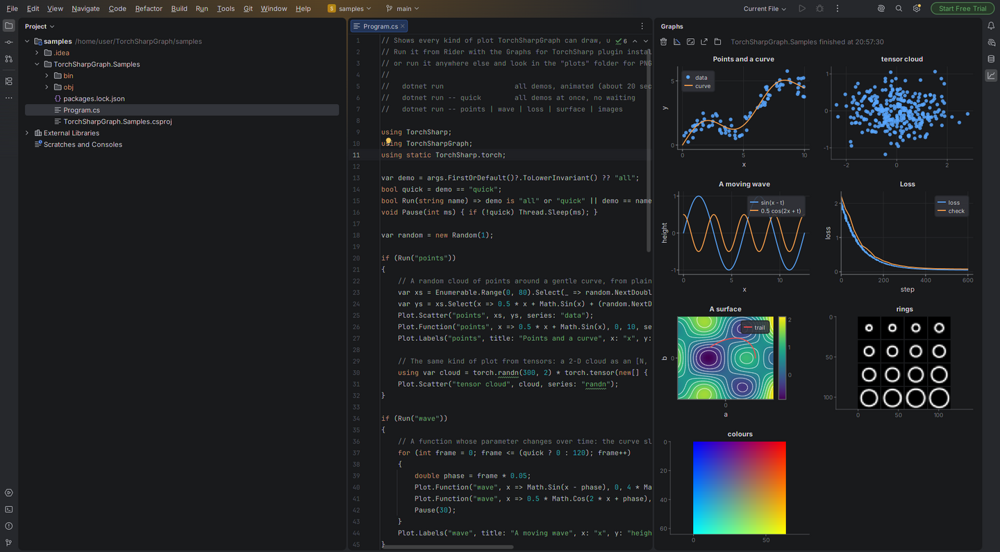

# TorchSharpGraph

Live plots for C# machine learning, inside JetBrains Rider. Your program calls a small library while it runs, and
Rider's **Graphs** window draws the data points, the curve moving into place, and the loss going down.



## What it does

- Scatter, line and function plots (`x => ...` lambdas), loss curves with a log-scale switch, heatmaps with
  contour lines, and tensors shown as pictures (one, or a grid of a batch).
- Accepts TorchSharp tensors, arrays and lists, and explains clearly when a shape is wrong.
- Hover to read values, scroll to zoom, drag to move, double-click to reset, export as PNG.
- Matches Rider's light and dark themes and stays sharp on scaled screens.
- Talks over 127.0.0.1 only. Without Rider, the plots are saved as PNG files when the program ends.

## Requirements

- Rider 2026.1 or newer (the plugin also runs in other JetBrains IDEs 2026.1+).
- .NET 8 or newer, and TorchSharp 0.107 if you plot tensors.

## Install

1. The plugin: Rider → Settings → Plugins → ⚙ → Install Plugin from Disk… → pick `torchsharpgraph-<version>.zip`
   (from the CI build, or `./gradlew buildPlugin` → `build/distributions/`).
2. The library: add the `TorchSharpGraph` package to your project (until it is on NuGet, build it with
   `dotnet pack dotnet/src/TorchSharpGraph` and add the folder as a package source, or reference the project).

## Quick start

```csharp
using TorchSharpGraph;

Plot.Scatter("data", xs, ys);                                   // points
Plot.Function("data", x => a * x + b, -3, 3, series: "model");  // a curve from a lambda; call again to move it
for (int step = 0; step < 1000; step++)
    Plot.Loss(step, loss);                                      // a double or a one-number tensor
Plot.Heatmap("surface", (a, b) => f(a, b), -2, 2, -2, 2, contours: 10);
Plot.Image("digits", batch);                                    // [N, 1, 28, 28] shows a grid of pictures
```

Run the program from Rider: the Graphs window opens by itself. The sample in
[`samples/TorchSharpGraph.Samples`](samples/TorchSharpGraph.Samples) shows every plot type.
More: [user guide](docs/USER-GUIDE.md).

## Credits

Written by Jacob Goodchild. MIT licence. PNG files are drawn with [ScottPlot](https://scottplot.net) (MIT); heatmaps
use the viridis colours from matplotlib (CC0). Details: [THIRD-PARTY-NOTICES.md](THIRD-PARTY-NOTICES.md).

TorchSharpGraph is an independent project, not made or endorsed by JetBrains, Microsoft or the .NET Foundation.
Rider is a trademark of JetBrains. TorchSharp is a .NET Foundation project, named here only to say what this works with.
